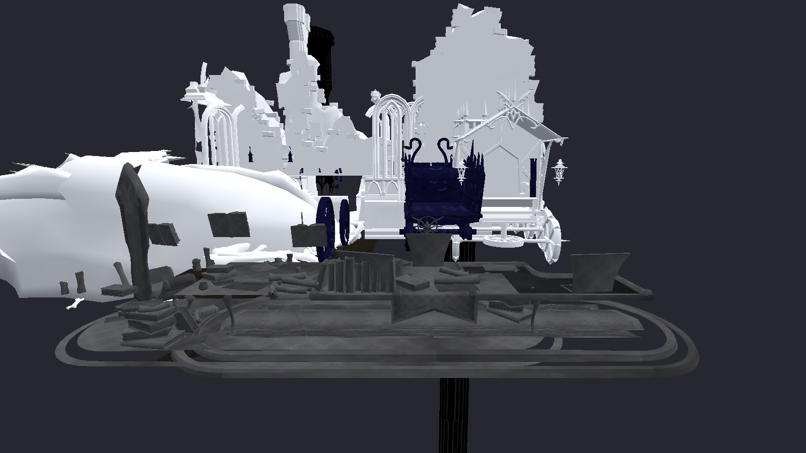
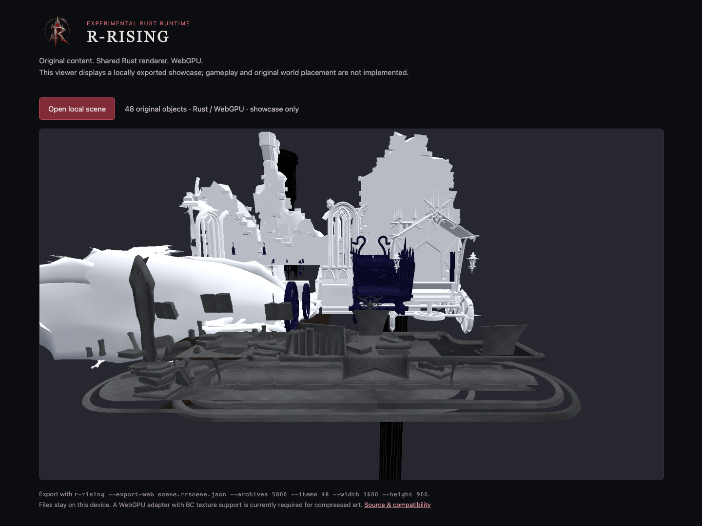
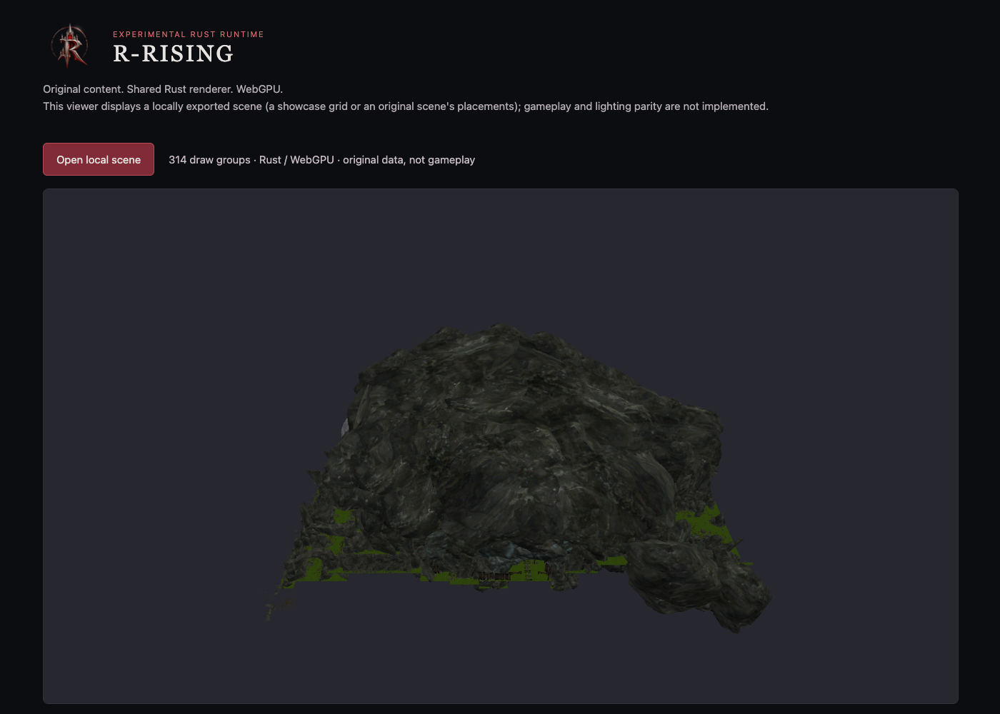
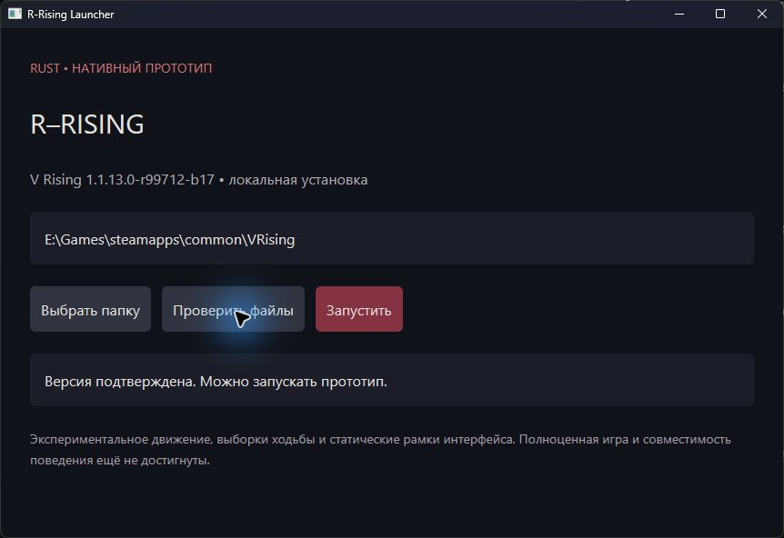

# R-Rising

[Project site & progress](https://lakomoor.github.io/R-Rising/) · [Browser viewer](https://lakomoor.github.io/R-Rising/viewer/)

An independent **Rust + wgpu** runtime targeting compatibility with **V Rising**,
including native desktop and **WebAssembly / WebGPU**. Loads content from a local
game installation. Original game files are not distributed.

**Early development:** real-content readers and a basic renderer work; this is
not yet a playable game. The goal is 1:1 behavior. No full-game parity or
performance improvement has been demonstrated.

## Progress

| Metric | Measured | Share / status |
| --- | --- | --- |
| Managed API member name matches | 5,119 / 187,377 | **2.7319% heuristic coverage** |
| `Unity.Mathematics` member name matches | 4,850 / 4,961 | **97.8% heuristic coverage** |
| `Unity.Entities` member name matches | 263 / 8,486 | **3.1% heuristic coverage** |
| Game-authored member name matches | 6 / 79,642 | **0.0075%**, not gameplay coverage |
| Content archives indexed | 4,409 / 4,409 | **100% of this installation** |
| RuntimeContentCatalog | 1 / 1 | Parsed and used by native startup; 1,904 dependency sets |
| Entity scene containers and streams decoded | 1,183 / 1,183 | **100% parsing; not world execution** |
| Scene archetypes with recovered storage shape | 17,579 / 17,579 (31,723 / 31,723 chunks; 1,385,671 entities) | Validated offline by layout/buffer/patch checks; managed components admitted only as 4-byte slots; not world execution |
| Native showcase | 48 objects, 26 bound textures | Verified on macOS / Metal |
| Browser showcase | Same 48 exported objects | Verified in Chrome / WebGPU |
| Original-game scenarios | 0 | Game parity **unmeasured**; 119 distinct native function addresses have replay tests (sqrt stub; steering isolates five ECS accessors); see [oracle evidence](evidence/original_leaf_oracles.md) |
| Original runtime reference | Dedicated server boots through CrossOver; six autosaves captured | [Measured startup/save evidence](evidence/crossover_runtime.md); no deterministic Rust comparison yet |
| Save index vs original debug dump | 136 / 136 archetypes agree on chunk count, entity count and included/excluded component names; 133 / 133 serialized byte spans match exactly (one server autosave) | Structure only; no component bytes or shared values compared. See [save bindings](evidence/save_bindings.md) |
| Saves | Containers, complete headers and all 8 serialization jobs read across two original autosaves; 274,238 and 274,236 entity rows | Partial ECS restore admits all 278 observed column types in two newer autosaves and 49 tag types; six shared-component types remain unprojected. [Save allocation and query evidence](evidence/save_bindings.md) |
| Gameplay / HUD | Diagnostic movement, sampled animation and eight static original slot frames | No inventory, HUD state, collision or original scheduler; not playable |
| Physics, audio, networking | Not implemented | Not playable |
| Rust-only timings (Apple M4, release) | Index 4,409 archives 3.3 s; decode 1,183 scenes 1.3 s; offscreen 1280x720 frame median 1.4 ms | Absolute numbers only, **no original-game comparison**; see COMPATIBILITY.md |

Name matching can over-count shared identifiers and does not prove correctness,
overload coverage, or runtime wiring. There is no defensible overall “game
completion” percentage yet. Regenerate [progress.json](docs/progress.json) with
`python3 tools/port_coverage.py --json`. Details and limitations:
[compatibility ledger](docs/COMPATIBILITY.md), [historical evidence](docs/PORT.md).

## Screenshots

The first pair arranges original models and textures in a demonstration grid; it
shows no original world placement.

**Native Rust / Metal — 1600 × 900**



**The shared Rust renderer in Chrome / WebGPU**



**Original scene placement** (`--scene`): the entities of one shipped scene
(`Silver_Mountain01`, 9,898 entities with a serialized `LocalToWorld`) drawn at
their **original placements** with the original meshes, sub-meshes and base-map
textures, framed by an automatic camera. Placement comes from original scene data.
This is **not gameplay and not lighting parity**: one directional light, no LODs,
skinned meshes, real material parameters or terrain blending. Alpha-tested
materials are cut out at a fixed 0.5 threshold; transparent materials (fog sheets)
are excluded and counted. 9,474 instances drawn, 18 transparent instances excluded,
3 unresolved drawn as marker boxes; 1,691 grass instances show texture-array
layer 0 as an assumption.

Both images below come from the current build (the browser capture is Chrome / WebGPU, 314 draw groups, 74.7 MB local export, about 1.1 s to load from localhost, 0 page errors; the match to native was judged by eye, not by pixel diff).




```sh
r-rising --scene .../EntityScenes/c6d34432693f24046ae5916650cc70ef.0.entities \
  --type-layouts /tmp/rrising-type-layouts.json --archives 100000 --offscreen scene.png
r-rising --scene ... --export-web scene.rrscene.json   # same scene for the browser viewer
r-rising --scene ... --type-layouts /tmp/rrising-type-layouts.json --archives 100000 \
  --scene-sim 3 --compare /tmp/scene-comparison.json
```
Without `--offscreen` the window has a fly camera (WASD, Q/E, arrow keys, Shift).
`--scene-sim N` runs N fixed transform frames before drawing or exporting the scene.
`--compare` writes stored-versus-simulated PNGs, a pixel diff and timings. This compares
two Rust renders using the same GPU data, not a screenshot from the original game.

## Windows launcher (gpui-fast)

```powershell
./tools/run_launcher.ps1           # build and open the native launcher
./tools/run_launcher.ps1 -Check    # verify the local pinned installation only
```

The launcher uses `gpui-fast` 0.1.19. Choose the installation folder containing
`GameAssembly.dll`, verify its four pinned files, then launch the experimental
native player prototype. Hashing and the child process run off the UI thread.
The selected folder and launch log stay local in `target/launcher-config.json`
and `target/launcher-prototype.log`. `VRISING_DATA` overrides the saved folder
and must point to its `VRising_Data` directory.

This first launcher runs from a source checkout on Windows with Rust/Cargo and
PowerShell. Initial layout generation also requires Python 3 on PATH, or an
explicit interpreter path in `RRISING_PYTHON`. It starts the diagnostic scene
with WASD movement, sampled rest/walk animation and static HUD frames; gameplay,
collision and full HUD state remain incomplete. It is not a standalone binary
distribution or a browser launcher.



Verification: [launcher evidence](docs/verification/launcher-gpui-fast.json).

## Native build

Rust **1.99.0** is pinned in `rust-toolchain.toml`.

```sh
cargo build --locked
cargo run --locked -p rrising-app -- --data /path/to/VRising_Data
cargo run --locked --release -p rrising-app -- --data /path/to/VRising_Data \
  --bench --archives 100000 --frames 60   # Rust-only timings
cargo run --locked -p rrising-app -- --data /path/to/VRising_Data \
  --offscreen frame.png --archives 5000 --items 48 --width 1600 --height 900
```

Run from the repository root. Default content path: `../VRising_Data`; default
type-tree package: `assets/typetrees.tpk`. Override with `--data`, `--tpk`,
`VRISING_DATA`, or `RRISING_TPK`. The default window renders a static showcase.

On macOS, owners of the pinned Windows client can launch the experimental player diagnostic:

```sh
tools/run_player_prototype.sh --check
tools/run_player_prototype.sh
```

On Windows, from the repository root (Python 3 and Cargo must be on PATH):

```powershell
./tools/run_player_prototype.ps1 -Check
./tools/run_player_prototype.ps1
```

The PowerShell launcher defaults to the adjacent `VRising_Data` directory. Use
`-Data`, `-Python`, `-Layout`, `-Scene` or `-Position` to override its inputs.
The generated local layout report is kept in the ignored `target` directory.
On the pinned Windows installation, an offscreen diagnostic frame and a synthetic
W press/release test succeeded. A short W press in the real window was delivered and
moved the diagnostic player; its timing and movement have not been compared to the game.
[Windows diagnostic frame with candidate face and static action-bar frames](docs/screenshots/action-bar-diagnostic.png).

The script verifies the client build, derives a temporary layout report if needed, and starts
the scene with experimental WASD motion, a following camera and walk samples. Set
`VRISING_DATA` and optionally `RRISING_LAYOUT_REPORT` if the files are elsewhere; see
`tools/run_player_prototype.sh --help`. For the default scene the script uses a diagnostic
position chosen for visibility; `RRISING_PLAYER_POSITION=x,y,z` overrides it. Neither is a
recovered spawn or collision-checked position.
The player has a diagnostic standard face, but no complete materials, collision, original
gameplay animation or original scheduler. Face selection and attachment behavior remain unverified.
The candidate prefab's cloak uses a debug grid material, which is not verified as its in-game appearance.
The diagnostic switches between a serialized rest pose and walk samples based on horizontal
displacement; it does not evaluate the original Animator. Short presses are retained until a
simulation update, whose catch-up steps can overstate their duration. This is a technical
diagnostic, not a playable V Rising port.
The elevated camera is an approximation informed by a user-supplied gameplay image. The
diagnostic HUD contains only the eight original slot-frame sprites; it has no inventory,
interactions, health, minimap or original Canvas scaling. Camera, lighting and scene are not
matched to the original.

Inspect a local dedicated-server autosave without starting the renderer:

```sh
cargo run --locked -p rrising-app -- --inspect-save /path/to/AutoSave_4.save.gz
```

The report includes the header, counts for every serialization job, indexed
entity slots, world slot capacity and saved system records. See
[save format evidence](evidence/save_jobs.md) for the measured scope.

## Browser build

The browser uses the **same wgpu renderer and shader** as native. The native Unity
reader is an optional adapter; it is excluded from the browser dependency graph.
A locally exported scene provides real geometry, material textures, and transforms.
This is an intermediate content-transfer path, not direct browser loading of the
whole game installation.

```sh
cargo run --locked -p rrising-app -- --data /path/to/VRising_Data \
  --export-web scene.rrscene.json --archives 5000 --items 48 --width 1600 --height 900
cargo install wasm-bindgen-cli --version 0.2.130 --locked
./tools/build_web.sh
python3 -m http.server 8080 --directory web --bind 127.0.0.1
```

Open `http://localhost:8080` in a WebGPU browser and choose **Open local scene**.
The file is read on-device. Exports contain original game art and are excluded
from Git; do not publish or share them. Generated WASM/JS are build outputs, also excluded from Git.

To export an original scene with the diagnostic player and action-bar frames,
add `--scene /path/to/scene.0.entities --type-layouts /path/to/layout.json --spawn-player
--player-position 142.5,20,22.5 --animation-frame 6 --diagnostic-hud` to the export
command. The position is a diagnostic assumption. Click the canvas and use WASD to move
the diagnostic player. The browser runs the same limited Rust ECS movement driver as the
native diagnostic and switches between rest and 24 sampled walk poses. Collision, original
Animator state, gameplay and parity with the original remain unverified or unimplemented.
[Chrome movement capture](docs/screenshots/browser-player-motion.png) ·
[measured browser input](docs/verification/browser-player-motion.json).

Requires WebGPU. BC1/3/4/5/6H/7 textures now decode on the CPU when BC compression
is unavailable; BC6H/BC7 also decode for correct row orientation. This costs load
time and GPU memory. Chrome was checked with BC excluded from the adapter and
actual device. Physical mobile devices, browser archive import, world streaming,
touch controls and gameplay remain unverified or pending. There is no WebGL fallback.
See [the measured fallback limits](docs/COMPATIBILITY.md#2026-11-17-bc-texture-fallback-and-correct-row-orientation).

## Validation

```sh
cargo check --workspace --locked
cargo test --locked -p rrising-math -p rrising-ecs -p rrising-render
cargo build --locked -p rrising-web --target wasm32-unknown-unknown
# Local install integration; needs this exact reference build and test paths:
cargo test --locked -p rrising-content
```

Reference build: `v1.1.13.0-r99712-b17 (202605251526)`, Unity `2022.3.58f1`.
Some legacy integration tests still use the development installation path; the
portable CI job deliberately runs only asset-independent checks. No missing
installation is counted as a successful original-game compatibility test.

## Architecture

| Crate | Responsibility |
| --- | --- |
| `rrising-math` | Ported math surface; known numeric deviations remain |
| `rrising-ecs` | Entity store, queries, World, deterministic schedule and one transform system; not a running game |
| `rrising-content` | Unity archives, objects, scenes, saves, settings, localization |
| `rrising-core` | Scene assembly and base-map selection for the showcase |
| `rrising-render` | Shared GPU pipeline, texture uploads with BC CPU fallback, scene transfers, readback |
| `rrising-app` | Native window, offscreen capture and local scene export |
| `rrising-web` | Async WebGPU initialization and browser host |

Read original component storage without starting a window:

```sh
python3 tools/probe_type_registry.py --check --output /tmp/rrising-layouts.json
cargo run --locked -p rrising-app -- --inspect-scene /path/to/file.entities \
  --type-layouts /tmp/rrising-layouts.json
```

The report is derived from your pinned local install and remains local. Unknown
archetypes are reported, never assigned guessed layouts. This command restores
chunk metadata and reads component bytes; it does not run gameplay.

Next: original scene-to-world wiring and a measured playable vertical slice;
portable texture fallback; original-runtime golden scenarios and comparable
release performance measurements.

## Branding and licenses

[Cover](docs/branding/cover.png) · [Transparent logo](docs/branding/logo.png) ·
[Generation prompts](docs/branding/PROMPTS.md)

Original Rust code: MIT OR Apache-2.0. Native content-reader dependencies are
GPL-3.0-or-later; the combined distribution must meet their license obligations.
See [third-party notices](THIRD_PARTY.md). V Rising and its assets belong to
Stunlock Studios. This is an independent project.
