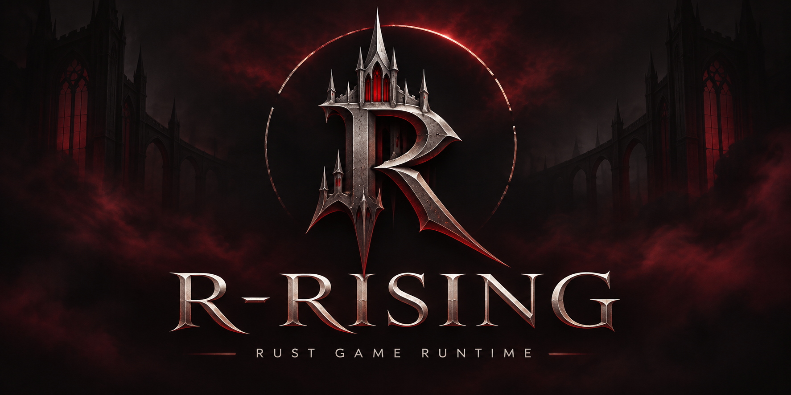
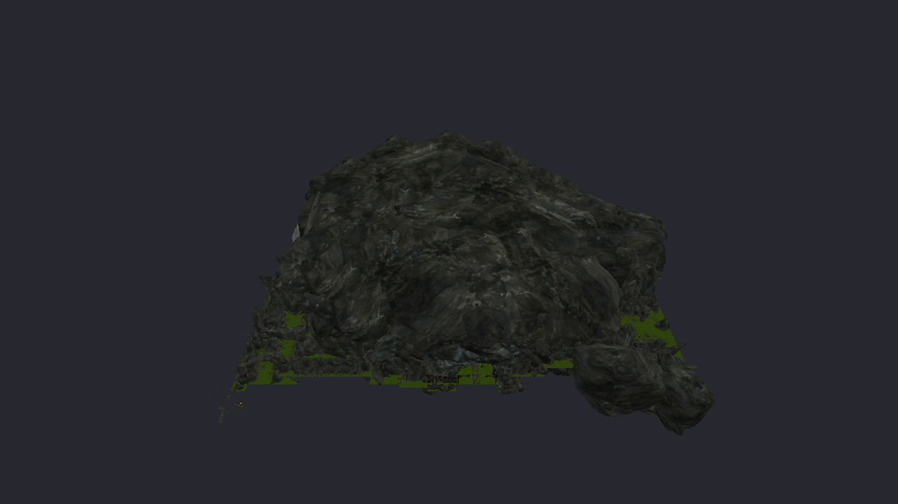

# R-Rising

[Project site & progress](https://lakomoor.github.io/R-Rising/) · [Browser viewer](https://lakomoor.github.io/R-Rising/viewer/)

An independent **Rust + wgpu** runtime targeting compatibility with **V Rising**,
including native desktop and **WebAssembly / WebGPU**. Loads content from a local
game installation. Original game files are not distributed.

**Early development:** real-content readers and a basic renderer work; this is
not yet a playable game. The goal is 1:1 behavior. No full-game parity or
performance improvement has been demonstrated.

## Progress

| Metric | Measured | Share / status |
| --- | --- | --- |
| Managed API member name matches | 5,107 / 187,377 | **2.7% heuristic coverage** |
| `Unity.Mathematics` member name matches | 4,850 / 4,961 | **97.8% heuristic coverage** |
| `Unity.Entities` member name matches | 256 / 8,486 | **3.0% heuristic coverage** |
| Game-authored member name matches | 1 / 79,642 | **0.0013%**, not gameplay coverage |
| Content archives indexed | 4,409 / 4,409 | **100% of this installation** |
| RuntimeContentCatalog | 1 / 1 | Parsed and used by native startup; 1,904 dependency sets |
| Entity scene containers and streams decoded | 1,183 / 1,183 | **100% parsing; not world execution** |
| Scene archetypes with recovered storage shape | 17,579 / 17,579 (31,723 / 31,723 chunks; 1,385,671 entities) | Validated offline by layout/buffer/patch checks; managed components admitted only as 4-byte slots; not world execution |
| Native showcase | 48 objects, 26 bound textures | Verified on macOS / Metal |
| Browser showcase | Same 48 exported objects | Verified in Chrome / WebGPU |
| Original-game scenarios | 0 | Game parity **unmeasured**; 7 native leaf functions match 1,024 original inputs each |
| Gameplay, HUD, animation, physics, audio, networking, saves | Not implemented | Not playable |
| Rust-only timings (Apple M4, release) | Index 4,409 archives 3.3 s; decode 1,183 scenes 1.3 s; offscreen 1280x720 frame median 1.4 ms | Absolute numbers only, **no original-game comparison**; see COMPATIBILITY.md |

Name matching can over-count shared identifiers and does not prove correctness,
overload coverage, or runtime wiring. There is no defensible overall “game
completion” percentage yet. Regenerate [progress.json](docs/progress.json) with
`python3 tools/port_coverage.py --json`. Details and limitations:
[compatibility ledger](docs/COMPATIBILITY.md), [historical evidence](docs/PORT.md).

## Screenshots

The first pair arranges original models and textures in a demonstration grid; it
shows no original world placement.

**Native Rust / Metal — 1600 × 900**


**The shared Rust renderer in Chrome / WebGPU**


**Original scene placement** (`--scene`): the entities of one shipped scene
(`Silver_Mountain01`, 9,898 entities with a serialized `LocalToWorld`) drawn at
their **original placements** with the original meshes, sub-meshes and base-map
textures, framed by an automatic camera. Placement comes from original scene data.
This is **not gameplay and not lighting parity**: one directional light, no LODs,
skinned meshes, real material parameters or terrain blending. Alpha-tested
materials are cut out at a fixed 0.5 threshold; transparent materials (fog sheets)
are excluded and counted. 9,474 instances drawn, 18 transparent instances excluded,
3 unresolved drawn as marker boxes; 1,691 grass instances show texture-array
layer 0 as an assumption.

Both images below come from the current build (the browser capture is Chrome / WebGPU, 314 draw groups, 74.7 MB local export, about 1.1 s to load from localhost, 0 page errors; the match to native was judged by eye, not by pixel diff).




```sh
r-rising --scene .../EntityScenes/c6d34432693f24046ae5916650cc70ef.0.entities \
  --type-layouts /tmp/rrising-type-layouts.json --archives 100000 --offscreen scene.png
r-rising --scene ... --export-web scene.rrscene.json   # same scene for the browser viewer
```
Without `--offscreen` the window has a fly camera (WASD, Q/E, arrow keys, Shift).

## Native build

Rust **1.99.0** is pinned in `rust-toolchain.toml`.

```sh
cargo build --locked
cargo run --locked -p rrising-app -- --data /path/to/VRising_Data
cargo run --locked --release -p rrising-app -- --data /path/to/VRising_Data \
  --bench --archives 100000 --frames 60   # Rust-only timings
cargo run --locked -p rrising-app -- --data /path/to/VRising_Data \
  --offscreen frame.png --archives 5000 --items 48 --width 1600 --height 900
```

Run from the repository root. Default content path: `../VRising_Data`; default
type-tree package: `assets/typetrees.tpk`. Override with `--data`, `--tpk`,
`VRISING_DATA`, or `RRISING_TPK`. The windowed application currently renders a
static showcase; there are no game controls yet.

## Browser build

The browser uses the **same wgpu renderer and shader** as native. The native Unity
reader is an optional adapter; it is excluded from the browser dependency graph.
A locally exported scene provides real geometry, material textures, and transforms.
This is an intermediate content-transfer path, not direct browser loading of the
whole game installation.

```sh
cargo run --locked -p rrising-app -- --data /path/to/VRising_Data \
  --export-web scene.rrscene.json --archives 5000 --items 48 --width 1600 --height 900
cargo install wasm-bindgen-cli --version 0.2.130 --locked
./tools/build_web.sh
python3 -m http.server 8080 --directory web --bind 127.0.0.1
```

Open `http://localhost:8080` in a WebGPU browser and choose **Open local scene**.
The file is read on-device. Exports contain original game art and are excluded
from Git. Generated WASM/JS are build outputs, also excluded from Git.

Currently requires WebGPU and a GPU exposing **BC texture compression** for the
compressed art in this PC build. Mobile GPU fallback, browser archive import,
world streaming, touch controls and gameplay are still pending. Windows, Linux,
Android and iOS execution have not been verified. There is no WebGL fallback.

## Validation

```sh
cargo check --workspace --locked
cargo test --locked -p rrising-math -p rrising-ecs -p rrising-render
cargo build --locked -p rrising-web --target wasm32-unknown-unknown
# Local install integration; needs this exact reference build and test paths:
cargo test --locked -p rrising-content
```

Reference build: `v1.1.13.0-r99712-b17 (202605251526)`, Unity `2022.3.58f1`.
Some legacy integration tests still use the development installation path; the
portable CI job deliberately runs only asset-independent checks. No missing
installation is counted as a successful original-game compatibility test.

## Architecture

| Crate | Responsibility |
| --- | --- |
| `rrising-math` | Ported math surface; known numeric deviations remain |
| `rrising-ecs` | ECS primitives and storage layout, not a running game world |
| `rrising-content` | Unity archives, objects, entity scene streams, settings, localization |
| `rrising-core` | Scene assembly and base-map selection for the showcase |
| `rrising-render` | Shared GPU pipeline, mesh/texture uploads, scene transfers, readback |
| `rrising-app` | Native window, offscreen capture and local scene export |
| `rrising-web` | Async WebGPU initialization and browser host |

Read original component storage without starting a window:

```sh
python3 tools/probe_type_registry.py --check --output /tmp/rrising-layouts.json
cargo run --locked -p rrising-app -- --inspect-scene /path/to/file.entities \
  --type-layouts /tmp/rrising-layouts.json
```

The report is derived from your pinned local install and remains local. Unknown
archetypes are reported, never assigned guessed layouts. This command restores
chunk metadata and reads component bytes; it does not run gameplay.

Next: original scene-to-world wiring and a measured playable vertical slice;
portable texture fallback; original-runtime golden scenarios and comparable
release performance measurements.

## Branding and licenses

[Cover](docs/branding/cover.png) · [Transparent logo](docs/branding/logo.png) ·
[Generation prompts](docs/branding/PROMPTS.md)

Original Rust code: MIT OR Apache-2.0. Native content-reader dependencies are
GPL-3.0-or-later; the combined distribution must meet their license obligations.
See [third-party notices](THIRD_PARTY.md). V Rising and its assets belong to
Stunlock Studios. This is an independent project.
